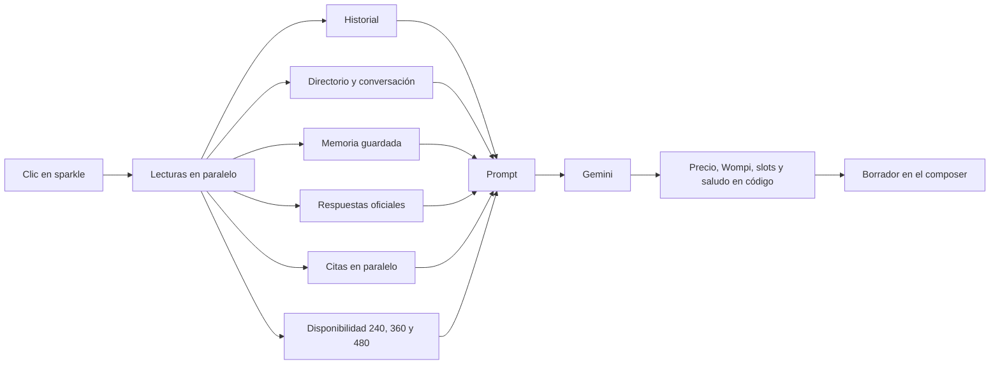

# Autorespuesta del CRM más rápida

**Estado:** implementación en código, sin deploy  
**Fecha:** 11/11/2026  
**Proyecto:** `Prosavis-CRM-WhatsApp`, rama `master` (HEAD de partida `6a01963`)  
**Producción al corte:** Edge `suggest-whatsapp-agent-reply` v88, Supabase `djzwjaegxbhlefanmmee`

## 1. Propósito

La sugerencia del botón ✨ funciona y no se envía sola, pero tarda. En 13 generaciones del 9 al 11 nov 2026 el p50 fue unos 28 s y el máximo 67,5 s. Este diseño la acelera sin reescribirla.

La sugerencia sigue siendo un borrador para una persona. Nada sale solo por el 312 ni por el 311.

## 2. Decisiones

- Se implementan F0, F1, F2 y F3 en `master`. No hay rama `feature/`.
- Un solo ✨. La instrucción extra es un campo opcional en el mismo flujo.
- El 401 del puente de disponibilidad se revisa en código. El secreto no se cambia sin un OK explícito en el momento de tocarlo.
- `INBOX_AI_SUGGEST_PIPELINE` sin valor queda en `legacy` (dos llamadas). `single` es la llamada fusionada y solo se activa en producción con OK.
- Grok Inbox (`get-inbox-ai-context`) sigue viendo el nombre de la auxiliar. La sugerencia al cliente no.
- Cada deploy, migración y secreto espera el OK de Nicolás. GitHub Actions sigue apagado.

## 3. Qué está mal hoy

1. Booking y sugerencia son dos llamadas a `gemini-3.8-flash` en serie, sin `thinkingLevel` (el modelo usa medium). A veces hay una tercera llamada: el refresco de memoria.
2. El bloque de contexto se manda dos veces.
3. Las lecturas van en serie. Las citas hacen hasta 6 consultas a Firestore una tras otra.
4. El análisis de imágenes sin caché corre al inicio, imagen por imagen, y el toggle del front lo deja encendido.
5. La disponibilidad real falló 13 de 13: 401 del puente o timeout de 4 s. Encabezados coinciden (`x-crm-secret` en `firebaseHttp.ts` y en `crmGetAvailableSlots`). El 401 es un secreto que no coincide, no un header mal nombrado.
6. El prompt nombra a la auxiliar y dice «Kit profesional». No hay regla de «la misma auxiliar».

## 4. Arquitectura

Con `INBOX_AI_SUGGEST_PIPELINE=single` hay una sola llamada y el prompt va en este orden: catálogo, cobertura y respuestas oficiales; memoria, ficha, citas sin auxiliar e historial corto; al final el momento actual y la instrucción del agente. El link Wompi lo agrega el código si falta.

Fuera del camino crítico: refresco de memoria (`scheduleBackgroundWork`), análisis de imagen al persistir el archivo, y el resumen del cajón A.

## 5. Reglas fijas de la sugerencia

- Borrador para una persona. Nada se envía solo.
- Precios solo del catálogo. El monto y el link los pone el código.
- No nombrar a la auxiliar salvo que el cliente lo exija, y nunca prometer la misma.
- El kit se escribe «Kit de limpieza Prosavis» (+$30.000). El monto no cambia.
- No se construye un «% de ocupación 110%».

## 6. Objetivos

- Servidor: p50 de 8 s o menos y p95 de 15 s o menos, medidos con el log `suggest-timing` después del deploy.
- Una llamada al modelo en el camino crítico cuando el flag `single` está activo. Ninguna llamada de memoria ni de imágenes en ese camino.
- Tokens de entrada en p95: 8.000 o menos.
- `edit_ratio` igual o mejor que la línea base. Rúbrica de 4/5 o más en al menos el 90 % de los casos y cero violaciones de las reglas fijas.

## 7. Rollback

- `GEMINI_THINKING_BOOKING` y `GEMINI_THINKING_SUGGEST`: `low` por defecto en código; `medium` vuelve al razonamiento anterior.
- `GEMINI_MODEL_BOOKING`: si está vacío, usa `GEMINI_MODEL_JSON` y si no `gemini-3.8-flash`.
- `INBOX_AI_SUGGEST_PIPELINE=legacy` conserva las dos llamadas y el historial largo.
- `INBOX_AI_SUGGEST_STREAM` y `INBOX_AI_SUGGEST_PREFETCH` salen apagados.
- `CRM_DIRECTORY_NOTES_SUMMARY=1` solo después de aplicar la migración del cajón A.

## 8. Qué no entra

- Envíos (`send-whatsapp-chat-message`, `send_template`, `whatsappOutbound.ts`, líneas 312 y 311).
- Cambiar precios o el catálogo, salvo el nombre del kit.
- Aplicar migraciones o desplegar Edges en este cambio.
- Guardar chats reales en el repo.

## 9. Línea base de calidad (antes de instrumentar)

Consulta de solo lectura a `whatsapp_ai_suggestion_log` el 11/11/2026, sin texto de mensajes. Proyecto `djzwjaegxbhlefanmmee`.

| Métrica | Valor |
| --- | --- |
| Filas | 552 |
| Filas con `edit_ratio` | 416 |
| `edit_ratio` p50 | 0,0321 |
| `edit_ratio` p95 | 0,7750 |
| Primera fila | 2026-08-11 |
| Última fila | 2026-11-11 16:46 UTC |

El p50 y el p95 por etapa (`suggest-timing`) no existen todavía: el log se escribe al desplegar la Edge instrumentada. Hacen falta el OK de Nicolás y al menos 30 sugerencias nuevas. El script `scripts/suggest-timing-percentiles.mjs` calcula esos percentiles sobre líneas JSON locales.

La rúbrica fija vive en `suggestionRubric.ts` y se prueba sin chats reales. El experimento de thinking low frente a medium, y de Flash frente a Flash-Lite, no se corre desde el repo: `scripts/suggest-offline-eval.mjs` no llama a Gemini ni lee producción.
